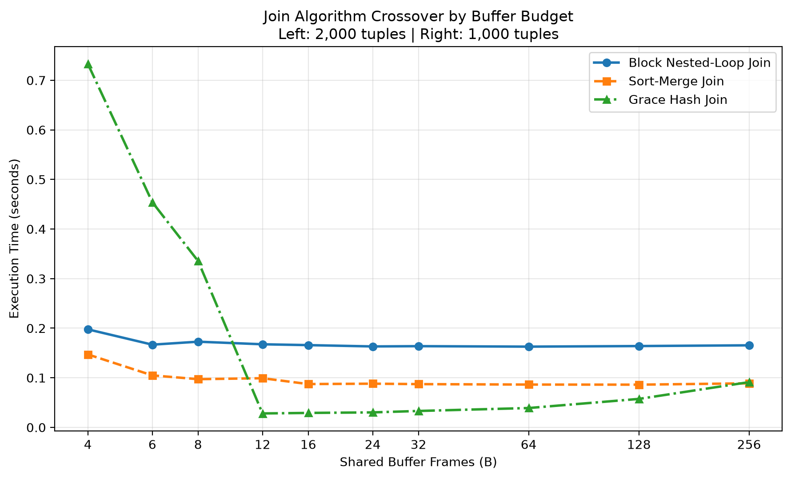
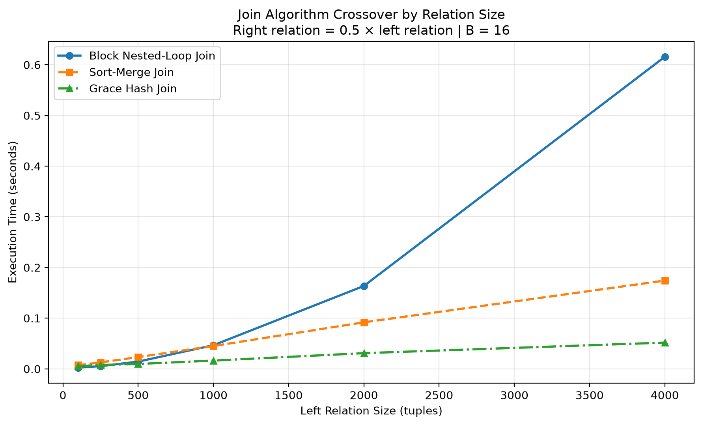

# Module 2: Execution Engine — Experimental Report

## 1. Introduction

This report evaluates the performance and memory behavior of the relational database execution engine developed for Module 2.

The execution engine implements an iterator-based execution model, a shared page-frame manager, external merge sorting, and three join algorithms:

- Nested Loop Join
- Sort Merge Join
- Grace Hash Join

Five experiments were conducted to evaluate the effects of relation size, available buffer frames, sorting passes, join-key distribution, and memory constraints.

The experiments focus on measured page I/O, execution time, algorithmic behavior, and correctness.

## 2. Experimental Setup and Methodology

All experiments were executed using the project's Python-based execution engine and disk-backed heap files.

The page size was 4,096 bytes. The shared page manager enforced a configurable buffer budget, denoted by B.

The experiments used synthetic relations with reproducible tuple structures and join-key distributions.

### 2.1 Performance Metrics

The following metrics were collected:

- **Page reads:** Page-read operations reported by execution operators.
- **Page writes:** Page-write operations reported by execution operators.
- **Total page I/O:** Sum of reported page reads and writes.
- **Execution time:** Wall-clock elapsed time measured using Python's `time.perf_counter()`.
- **Comparisons:** Comparison operations reported by the execution operators, where available.
- **Output cardinality:** Number of tuples produced by the query.
- **Buffer occupancy:** Number of distinct shared page frames occupied by cached, reserved, or pinned pages.
- **External-sort runs and passes:** Actual initial-run counts and merge-pass counts recorded by the Sort operator.

The reported I/O values are implementation-specific operator measurements. They are compared with theoretical I/O models to explain trends, but they should not be interpreted as identical accounting systems.

Execution times were measured using individual benchmark runs and may be influenced by operating-system scheduling, caching, and Python runtime overhead.

### 2.2 Experimental Programs

The following benchmark programs were used:

| Experiment | Program | Results |
|---|---|---|
| 1. Join Costs | `experiments/m2/join_costs.py` | `experiments/m2/results/join_costs.csv` |
| 2. External Sort | `experiments/m2/sort_passes.py` | `experiments/m2/results/sort_passes.csv` |
| 3. Join Crossover | `experiments/m2/join_crossover.py` | `experiments/m2/results/join_crossover.csv` |
| 4. Hash Join Skew | `experiments/m2/hash_skew.py` | `experiments/m2/results/hash_skew.csv` |
| 5. Memory Stress | `experiments/m2/memory_stress.py` | `experiments/m2/results/memory_stress.csv` |

A total of 100 benchmark configurations or executions were completed across the five experiments.

---

## 3. Experiment 1: Join Algorithm Cost Comparison

### 3.1 Objective

The objective was to compare the I/O costs of Nested Loop Join, Sort Merge Join, and Grace Hash Join under different relation sizes and buffer budgets.

The experiment examined whether the measured behavior followed the expected theoretical trends.

### 3.2 Experimental Configuration

Three relation-size configurations were used:

| Size | Left Tuples | Right Tuples | Left Data Pages | Right Data Pages |
|---|---:|---:|---:|---:|
| Small | 100 | 50 | 3 | 2 |
| Medium | 500 | 250 | 11 | 6 |
| Large | 2,000 | 1,000 | 41 | 21 |

Each join algorithm was evaluated with buffer budgets of B = 4, 16, 64, and 256.

This produced 36 configurations.

### 3.3 Measured Results

The following table presents the reported total page I/O for each configuration.

| Relation Size | B | Nested Loop | Sort Merge | Grace Hash |
|---|---:|---:|---:|---:|
| Small | 4 | 23 | 128 | 25 |
| Small | 16 | 20 | 128 | 71 |
| Small | 64 | 20 | 128 | 175 |
| Small | 256 | 20 | 128 | 261 |
| Medium | 4 | 87 | 606 | 1,069 |
| Medium | 16 | 56 | 584 | 95 |
| Medium | 64 | 56 | 584 | 281 |
| Medium | 256 | 56 | 584 | 793 |
| Large | 4 | 637 | 2,548 | 15,594 |
| Large | 16 | 238 | 2,300 | 262 |
| Large | 64 | 195 | 2,300 | 360 |
| Large | 256 | 195 | 2,300 | 1,118 |

### 3.4 Theoretical I/O Analysis

For a block nested-loop join, a commonly used theoretical I/O cost model is:

    Cost_BNLJ = M + ceil(M / (B - 2)) × N

where:

- M is the number of pages in the outer relation.
- N is the number of pages in the inner relation.
- B is the number of available buffer frames.

This assumes B - 2 pages can be used for an outer-relation block, with the remaining frames allocated to input and output processing.

Using the measured relation data-page counts, the theoretical block nested-loop costs are:

| Size | B = 4 | B = 16 | B = 64 | B = 256 |
|---|---:|---:|---:|---:|
| Small | 7 | 5 | 5 | 5 |
| Medium | 47 | 17 | 17 | 17 |
| Large | 482 | 104 | 62 | 62 |

The theoretical costs are lower than the measured operator I/O values. This is expected because the textbook model excludes implementation-specific overhead and assumes an idealized page-access pattern.

For Grace Hash Join, the standard idealized two-pass cost is:

    Cost_GHJ = 3 × (M + N)

This assumes that partitioning requires reading and writing both relations once, followed by reading the partitions once during the join phase.

The resulting theoretical costs are:

| Relation Size | Ideal Grace Hash I/O |
|---|---:|
| Small | 15 |
| Medium | 51 |
| Large | 186 |

These values assume partitions fit into the available memory during the join phase. They do not apply directly when the implementation falls back to repeated disk scans or incurs additional partition overhead.

Sort Merge Join requires sorting the inputs before merging them unless they are already sorted.

Its theoretical cost depends on the number of initial runs, the available merge fan-in, and whether the final merge can be pipelined into the join.

Consequently, its measured I/O should be interpreted using the external-sort pass analysis presented in Experiment 2 rather than a single fixed cost formula.

### 3.5 Analysis

**Nested Loop Join**

Nested Loop Join frequently reported the lowest page I/O, particularly for small and medium relations.

Increasing the buffer budget reduced its measured I/O for larger relations. For the large configuration, I/O decreased from 637 operations at B = 4 to 195 operations at B = 64.

The results are consistent with the expectation that additional memory can reduce repeated input scans.

However, Nested Loop Join still performs substantial tuple-comparison work as the relations grow.

**Sort Merge Join**

Sort Merge Join reported relatively high I/O across all relation sizes.

For the large configuration, it required 2,548 page operations at B = 4 and 2,300 operations at B = 16.

The additional I/O is consistent with the cost of generating and merging sorted runs before completing the join.

Once sufficient memory was available, further increases in B did not reduce its reported I/O for this workload.

**Grace Hash Join**

Grace Hash Join showed the greatest sensitivity to buffer size.

For the large relations, it required 15,594 page operations at B = 4 but only 262 operations at B = 16.

This sharp reduction is consistent with avoiding expensive partition-overflow fallback processing once sufficient memory becomes available.

At larger buffer budgets, its reported I/O increased again, reaching 1,118 operations at B = 256.

The implementation creates B - 1 partitions. Consequently, increasing B can introduce additional overhead from a larger number of small partition files.

### 3.6 Conclusion

The results demonstrate that the lowest-I/O algorithm depends on both relation size and available memory.

Nested Loop Join frequently minimized reported page I/O, while Grace Hash Join became much more efficient after its partition memory requirements could be satisfied.

The results also demonstrate that increasing the buffer budget does not necessarily reduce I/O for every algorithm or implementation.

---

## 4. Experiment 2: External Merge Sort Pass Analysis

### 4.1 Objective

The objective was to evaluate how the number of input pages and available buffer frames affects the number of external sorting passes and the total reported page I/O.

The experiment also included the required N = 20B configuration.

### 4.2 Experimental Configuration

Seven configurations were tested.

The input relations contained exactly 8, 20, 40, or 80 data pages.

Buffer budgets of B = 4, 8, 16, and 32 were evaluated.

The input tuples were generated with descending sort keys, and the sort operator was required to produce ascending output.

Each benchmark verified the resulting tuple count and ordering.

The Sort operator was instrumented to record the number of initial sorted runs, intermediate merge passes, and final streaming merge passes.

### 4.3 Theoretical Sorting Model

For an external merge sort using B buffer frames, the theoretical number of initial runs is:

    Initial Runs = ceil(N / B)

The merge fan-in is:

    Fan-in = B - 1

The theoretical number of merge passes is determined by repeatedly reducing the number of runs by a factor of B - 1 until one run remains.

The theoretical pass model assumes page-based run formation using all B frames. Actual implementation behavior can differ because run generation reserves frames for input and output processing and depends on serialized tuple sizes and temporary-page packing.

### 4.4 Measured Results

The following table compares theoretical predictions with actual run and merge-pass measurements.

| N | B | Theoretical Initial Runs | Actual Initial Runs | Theoretical Merge Passes | Actual Merge Passes | Reported Page I/O |
|---:|---:|---:|---:|---:|---:|---:|
| 8 | 4 | 2 | 4 | 1 | 2 | 39 |
| 20 | 4 | 5 | 10 | 2 | 3 | 135 |
| 40 | 4 | 10 | 21 | 3 | 3 | 279 |
| 80 | 4 | 20 | 42 | 3 | 4 | 747 |
| 80 | 8 | 10 | 14 | 2 | 2 | 415 |
| 80 | 16 | 5 | 6 | 1 | 1 | 249 |
| 80 | 32 | 3 | 3 | 1 | 1 | 249 |

The theoretical values were calculated using the external merge-sort cost model. Actual initial-run counts and merge-pass counts were recorded directly from the Sort operator during execution.

Actual merge-pass counts include intermediate disk-based merging and the final streaming merge when multiple runs remain. A final streaming merge does not necessarily require writing another complete temporary run to disk.

### 4.5 Analysis

#### 4.5.1 Theoretical vs. Actual Sorting Behaviour

The implementation was instrumented to record the actual number of initial sorted runs, intermediate merge passes, and final streaming merge passes. These measurements allow direct comparison with the theoretical external merge-sort model.

The results show that the implementation frequently generates more initial runs than predicted theoretically. This occurs because the implementation reserves part of its buffer budget for input and output processing rather than allocating all B frames to run generation. Actual run sizes also depend on tuple serialization and temporary-page packing.

For N = 80 and B = 4, the theoretical model predicts 20 initial runs and three merge passes. The implementation generated 42 initial runs and required four merge passes.

Additional initial runs do not always increase the number of merge passes. At N = 40 and B = 4, the implementation generated 21 runs instead of the predicted 10, but both required three merge passes because the number of passes depends on the available merge fan-in.

As the buffer budget increases, the theoretical and measured values converge. At N = 80 and B = 32, both models produce three initial runs and require one merge pass.

These findings demonstrate that theoretical sorting formulas provide useful performance estimates, but actual behavior depends on buffer allocation, serialized tuple sizes, and merge-pass boundaries.

#### 4.5.2 Effect of Relation Size

With B fixed at 4, increasing the input size increased the number of initial runs and the reported I/O.

For N = 8, the sort required 39 page operations and generated four initial runs.

For N = 80, the sort required 747 page operations and generated 42 initial runs.

The increase reflects the additional temporary runs and merge processing needed for larger inputs.

#### 4.5.3 Effect of Buffer Size

For the 80-page relation, increasing B from 4 to 8 reduced reported I/O from 747 to 415 operations.

Increasing B to 16 reduced it further to 249 operations.

This represents approximately a 66.7% reduction in reported I/O between B = 4 and B = 16.

Increasing B from 16 to 32 did not reduce I/O further.

Both configurations required one actual merge pass, so the larger buffer budget did not eliminate another pass.

#### 4.5.4 Required N = 20B Configuration

The N = 80, B = 4 configuration satisfies:

    N = 20 × B
    N = 20 × 4
    N = 80 pages

The sort completed successfully, produced correctly ordered output, and required 747 reported page I/O operations.

The instrumented Sort operator recorded 42 initial runs and four merge passes, compared with theoretical estimates of 20 initial runs and three merge passes.

### 4.6 Conclusion

The results demonstrate that increasing the available buffer budget can significantly reduce the number of initial sorted runs, merge passes, and associated page I/O.

Direct instrumentation confirmed that actual run counts can exceed theoretical estimates because the implementation reserves buffer frames for input and output processing. These additional runs sometimes require extra merge passes, particularly under small buffer budgets.

For the 80-page relation, increasing B from 4 to 16 reduced reported page I/O from 747 to 249 operations, a reduction of approximately 66.7%.

However, once the required merge-pass count stops decreasing, additional memory may provide little or no I/O improvement for the tested workload.

---

## 5. Experiment 3: Join Algorithm Crossover Analysis

### 5.1 Objective

The experiment evaluated Nested Loop Join, Sort Merge Join, and Grace Hash Join under two conditions:

1. Varying available buffer frames while holding relation sizes constant.
2. Varying relation sizes while holding the buffer budget constant.

The objective was to identify when the preferred join algorithm changed.

### 5.2 Memory Crossover

The first sweep used relations containing 2,000 and 1,000 tuples.

| B | Nested Loop I/O | Sort Merge I/O | Grace Hash I/O |
|---:|---:|---:|---:|
| 4 | 637 | 2,548 | 15,594 |
| 6 | 406 | 2,420 | 9,850 |
| 8 | 322 | 2,384 | 6,843 |
| 12 | 280 | 2,300 | 250 |
| 16 | 238 | 2,300 | 262 |
| 24 | 217 | 2,300 | 272 |
| 32 | 217 | 2,300 | 292 |
| 64 | 195 | 2,300 | 360 |
| 128 | 195 | 2,300 | 616 |
| 256 | 195 | 2,300 | 1,118 |

**Figure 1: Join Execution Time by Buffer Budget**



Figure 1 compares the measured execution times of the three join algorithms for fixed relations containing 2,000 and 1,000 tuples.

Grace Hash Join exhibited a significant performance improvement between B = 8 and B = 12.

Its measured page I/O decreased from 6,843 to 250 operations, representing approximately a 96.3% reduction.

Its execution time decreased from 0.3355 seconds to 0.0281 seconds.

At B = 12, Grace Hash Join achieved the lowest page I/O and execution time of the three algorithms.

At larger buffer budgets, its I/O increased, consistent with additional partition-management overhead.

### 5.3 Relation-Size Crossover

The second sweep fixed the buffer budget at B = 16.

| Left Rows | Right Rows | Nested Loop Time | Sort Merge Time | Grace Hash Time |
|---:|---:|---:|---:|---:|
| 100 | 50 | 0.0025 s | 0.0073 s | 0.0054 s |
| 250 | 125 | 0.0053 s | 0.0128 s | 0.0076 s |
| 500 | 250 | 0.0144 s | 0.0233 s | 0.0097 s |
| 1,000 | 500 | 0.0467 s | 0.0451 s | 0.0164 s |
| 2,000 | 1,000 | 0.1636 s | 0.0918 s | 0.0310 s |
| 4,000 | 2,000 | 0.6157 s | 0.1742 s | 0.0518 s |

**Figure 2: Join Execution Time by Relation Size**



Figure 2 compares the measured execution times at B = 16, with the right relation containing half as many tuples as the left relation.

Nested Loop Join was fastest for the smallest relations containing 100/50 and 250/125 tuples.

Grace Hash Join became fastest at 500/250 tuples and maintained its advantage for all larger tested relations.

At 4,000/2,000 tuples, Grace Hash Join completed in 0.0518 seconds, compared with 0.6157 seconds for Nested Loop Join.

This represents approximately an 11.9-times execution-time advantage.

### 5.4 Conclusion

Join algorithm performance depends on both relation size and available memory.

Nested Loop Join performed well for small relations and often minimized page I/O.

Grace Hash Join achieved superior execution times for larger relations once its partitions could be processed efficiently.

The observed crossover points are specific to this implementation and workload.

### 5.5 Measurement Limitations

Execution times were collected from individual runs and may be affected by system scheduling, caching, and measurement noise.

Page I/O values were obtained from execution-operator counters.

---

## 6. Experiment 4: Grace Hash Join Skew Sensitivity

### 6.1 Objective

This experiment evaluated the sensitivity of Grace Hash Join to uneven join-key distributions.

Two relations containing 500 and 250 tuples were tested under uniform and skewed distributions.

In the skewed workload, 40% of tuples in each relation shared the same join key.

Buffer budgets of B = 4, 8, 16, and 32 were evaluated.

The implementation was instrumented to record actual partition sizes and the number of partitions that triggered the disk-rescan fallback. These measurements were compared against predictions calculated using the join's partitioning function and memory-limit formula.

### 6.2 Measured Results

| B | Distribution | Predicted Overflow Partitions | Actual Overflow Partitions | Page I/O | Time |
|---:|---|---:|---:|---:|---:|
| 4 | Uniform | 3 | 3 | 1,069 | 0.0592 s |
| 4 | Skewed | 3 | 3 | 1,581 | 0.0898 s |
| 8 | Uniform | 0 | 0 | 75 | 0.0108 s |
| 8 | Skewed | 1 | 1 | 816 | 0.0508 s |
| 16 | Uniform | 0 | 0 | 95 | 0.0136 s |
| 16 | Skewed | 0 | 0 | 105 | 0.0139 s |
| 32 | Uniform | 0 | 0 | 157 | 0.0174 s |
| 32 | Skewed | 0 | 0 | 169 | 0.0180 s |

All eight configurations completed successfully, and the predicted overflow counts matched the actual runtime overflow counts in every case.

### 6.3 Actual Partition Sizes

The Grace Hash Join operator recorded the number of tuples written to each temporary partition during execution.

The largest observed partitions were:

| B | Distribution | Largest Left Partition (Rows) | Largest Right Partition (Rows) |
|---:|---|---:|---:|
| 4 | Uniform | 178 | 93 |
| 4 | Skewed | 305 | 160 |
| 8 | Uniform | 81 | 45 |
| 8 | Skewed | 246 | 122 |
| 16 | Uniform | 54 | 29 |
| 16 | Skewed | 224 | 111 |
| 32 | Uniform | 23 | 13 |
| 32 | Skewed | 209 | 105 |

The measurements demonstrate that skew concentrates a disproportionate number of tuples into individual hash partitions.

For B = 8, the largest uniform left partition contained 81 tuples, while the largest skewed left partition contained 246 tuples.

Increasing the buffer budget reduced the largest partition size in both workloads. However, the skewed workload continued to produce substantially larger individual partitions because all tuples sharing the hot key were assigned to the same partition.

At B = 32, the largest uniform left partition contained 23 tuples, compared with 209 tuples in the skewed workload.

### 6.4 Output Cardinality

The uniform workload generated 250 output tuples.

The skewed workload generated 20,050 output tuples because 200 left-side tuples and 100 right-side tuples shared the same key, producing 20,000 matches from that key alone.

The remaining matching keys produced an additional 50 tuples.

The skewed workload therefore generated approximately 80.2 times as many output tuples.

This difference must be considered when interpreting execution times, since producing additional result tuples introduces work independently of partition overflow.

### 6.5 Analysis

**Effect of partition overflow**

The largest relative I/O difference occurred at B = 8.

The uniform workload required 75 page operations and triggered no partition overflows.

The skewed workload required 816 page operations and triggered one partition overflow.

This represents approximately 10.9 times as much I/O.

Direct instrumentation confirmed that the skewed workload entered the disk-rescan fallback for one partition, while the uniform workload processed every partition without fallback.

The result demonstrates how a concentrated join-key distribution can cause an individual hash partition to exceed the available memory budget, even when a uniformly distributed workload of the same overall size does not.

**Effect of buffer size**

Increasing the buffer budget to B = 16 eliminated partition overflow in both workloads.

At B = 16, the reported I/O difference decreased to 95 operations for the uniform workload versus 105 for the skewed workload.

This indicates that sufficient buffer capacity can substantially reduce the I/O penalty associated with skewed partitions.

However, increasing B from 16 to 32 increased reported I/O for both distributions. This is consistent with the overhead of creating and managing a larger number of partitions.

**Predicted versus actual behavior**

The predicted and actual overflow counts agreed for all eight configurations.

This agreement validates the benchmark's overflow prediction for the tested workloads and confirms that the implementation's fallback behavior follows its configured hash-table memory limit.

Unlike the original analysis, which relied exclusively on predicted overflow counts, the updated experiment directly records fallback events during execution.

### 6.6 Conclusion

Grace Hash Join is sensitive to skew when the resulting partition imbalance causes memory overflow.

The measured partition sizes demonstrate that concentrated join keys produce substantially larger partitions than uniformly distributed keys.

Actual runtime instrumentation confirmed that the skewed B = 8 workload triggered one overflow, increasing reported I/O from 75 to 816 operations compared with the uniform workload.

Increasing the buffer budget to B = 16 eliminated overflow in both workloads and substantially reduced the I/O difference.

The experiment also demonstrates that output cardinality must be considered independently of partition overflow when evaluating execution time.

### 6.7 Measurement Limitations

The experiment used controlled synthetic distributions and single-run timing measurements.

Partition row counts and overflow events were recorded directly from the operator. The overflow predictions were calculated separately using the implementation's hash function and memory-limit formula.

The experiment also recorded actual temporary-partition page counts, although these were not included in the summary tables above.

The skewed workload produced substantially more output tuples than the uniform workload, affecting execution time independently of partition overflow.

---

## 7. Experiment 5: External Sort Memory-Budget Stress Test

### 7.1 Objective

The purpose of this experiment was to verify that the external merge-sort implementation could correctly process a relation significantly larger than the available memory while respecting the shared buffer-frame budget.

### 7.2 Experimental Configuration

A relation containing exactly 80 data pages and 3,635 tuples was generated.

The sort operator was executed with a buffer budget of B = 4 frames, satisfying the required N = 20B condition.

The experiment instrumented the shared page manager to monitor frame reservations, cached pages, and pinned pages throughout execution.

A total of 339 frame-state observations were collected.

### 7.3 Measured Results

| Metric | Result |
|---|---:|
| Input data pages | 80 |
| Buffer budget | 4 frames |
| Input tuples | 3,635 |
| Input-to-buffer ratio | 20 |
| Theoretical initial runs | 20 |
| Theoretical merge passes | 3 |
| Peak reserved frames | 4 |
| Peak cached frames | 2 |
| Peak pinned frames | 1 |
| Peak occupied frames | 4 |
| Final reserved frames | 0 |
| Final pinned frames | 0 |
| Frame observations | 339 |
| Reported total page I/O | 747 |
| Execution time | 0.0976 seconds |
| Correct output ordering | Yes |
| Memory budget respected | Yes |

### 7.4 Analysis

The maximum observed concurrent frame occupancy was four frames, equal to the configured buffer budget.

Peak temporary-frame reservations reached four frames, while peak cached and pinned frame counts were two and one, respectively.

These peak measurements did not necessarily occur simultaneously.

The external sort completed successfully, performing 747 reported page I/O operations.

All 3,635 output tuples were verified to be in ascending sort-key order.

After execution, no reserved or pinned frames remained, indicating that the operator released its shared-memory resources correctly.

### 7.5 Conclusion

The experiment demonstrates that the external sorting implementation successfully processes an input relation 20 times larger than the available buffer capacity without exceeding the four-frame shared buffer budget at the monitored state transitions.

The experiment validates shared page-frame usage rather than total Python process memory consumption.

---

## 8. Overall Discussion

The five experiments demonstrate several important characteristics of the execution engine.

### 8.1 Memory Availability

Buffer size has a substantial effect on execution performance.

Nested Loop Join benefits from larger buffers because they can reduce repeated scans.

External Merge Sort benefits from larger buffers because fewer runs and merge passes are required.

Grace Hash Join benefits from sufficient memory to accommodate its hash partitions.

However, additional memory does not always improve performance. In this implementation, Grace Hash Join can incur greater overhead when B increases the number of partitions beyond what is useful for the workload.

### 8.2 Relation Size

For small relations, Nested Loop Join can be efficient because its implementation overhead is relatively low.

As relation sizes increase, the growing number of tuple comparisons makes Nested Loop Join less competitive in execution time.

Grace Hash Join performed particularly well for larger relations when its hash partitions fit in memory.

### 8.3 Data Distribution

The skew experiment demonstrated that average relation size alone is insufficient to predict hash-join performance.

A large concentration of duplicate join keys can create oversized partitions and trigger expensive fallback processing.

The distribution of join keys must therefore be considered when selecting a join strategy.

### 8.4 Correctness and Memory Safety

The sorting experiments verified output cardinality and ordering.

The join experiments checked output cardinality.

The memory stress test additionally confirmed that the shared page manager did not exceed the configured four-frame budget at the monitored transitions.

No reserved or pinned frames remained after the stress-test execution.

---

## 9. Experimental Limitations

Several limitations should be considered when interpreting the results.

1. **Single-run timing measurements:** Execution times were not averaged across repeated runs. Small timing differences may therefore be unreliable.

2. **Operator-reported I/O:** The measured page operations include implementation-specific accounting. They are not necessarily directly equivalent to idealized textbook physical-I/O formulas.

3. **Synthetic datasets:** The experiments used controlled synthetic relations rather than production database workloads.

4. **External-sort model differences:** Theoretical initial-run and merge-pass counts use idealized page-based formulas. Actual counts were recorded directly from the Sort operator and may differ because of buffer allocation, tuple serialization, and temporary-page packing.

5. **Predicted hash overflow:** Overflow counts were calculated using the implementation's partitioning and memory-limit logic rather than captured as runtime overflow events.

6. **Shared-buffer monitoring:** The memory stress test measured shared page-frame occupancy, not total process memory or all Python object allocations.

7. **Join output size:** The skewed workload produced substantially more result tuples than the uniform workload, affecting execution time independently of partition overflow.

These limitations do not invalidate the observed results, but they define the scope of the conclusions.

---

## 10. Conclusion

The experimental evaluation demonstrates that the execution engine supports disk-backed relational processing under a configurable shared buffer budget.

The results confirm several expected database-system performance trends:

- Nested Loop Join can be effective for small relations but becomes less competitive as relation sizes increase.
- Sort Merge Join incurs additional sorting I/O when its inputs are not already ordered.
- Grace Hash Join can provide strong performance for larger relations when partitions fit into memory.
- External Merge Sort benefits from additional memory through reduced run and merge-pass counts.
- Actual external-sort run counts can exceed theoretical predictions because of implementation-specific buffer allocation.
- Skewed join-key distributions can significantly increase hash-join I/O when partitions overflow.
- External sorting can successfully process relations much larger than the available shared buffer capacity.

Across the five experiments, 100 benchmark executions or configurations were completed.

The final memory stress test demonstrated that the execution engine correctly sorted an 80-page relation using four shared buffer frames without exceeding the monitored frame budget.

Overall, the results show that relation size, buffer availability, data distribution, and implementation overhead must all be considered when evaluating execution strategies.

---

## 11. Reproducing the Experiments

Run the following commands from the repository root:

```bash
python3 -m experiments.m2.join_costs
python3 -m experiments.m2.sort_passes
python3 -m experiments.m2.join_crossover
python3 -m experiments.m2.hash_skew
python3 -m experiments.m2.memory_stress
python3 -m experiments.m2.plot_crossover
```

The corresponding CSV results and generated figures are written to:

`experiments/m2/results/`

To run the project's automated tests:

```bash
python3 -m pytest -q
```

To check code style and formatting:

```bash
python3 -m ruff check .
python3 -m ruff format --check .
```

The benchmark scripts, CSV outputs, and generated figures provide the supporting evidence for the results presented in this report.
